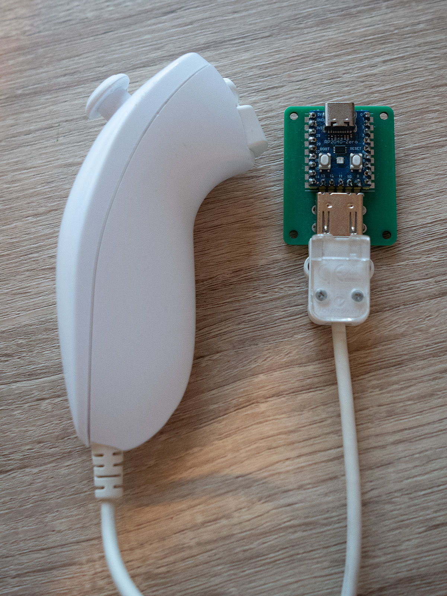
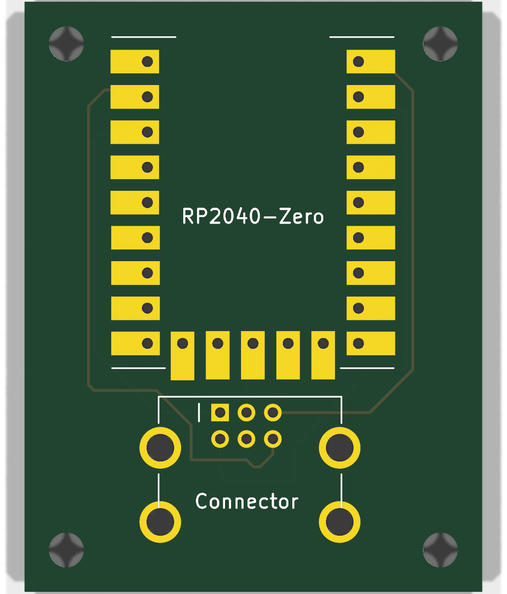
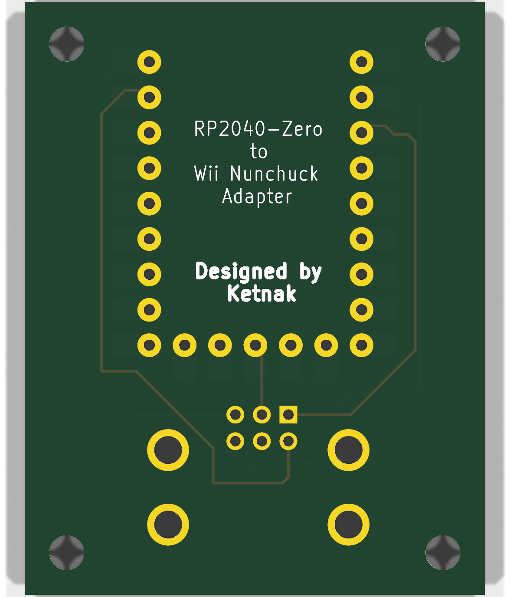

# NunchuckMouse

> PL: Wii Nunchuck jako mysz USB. Drążek rusza kursorem, Z to lewy klik, C to prawy. Firmware w Arduino na RP2040-Zero, który siedzi na mojej własnej płytce z gniazdem Wii, zaprojektowanej w KiCadzie. Działający prototyp, zbudowałem go i sam go używam.

A Wii Nunchuck used as a USB mouse. An RP2040-Zero reads the Nunchuck over I2C and shows up on the PC as a regular HID mouse, so it needs no driver. The module sits on a small PCB with a Wii extension socket that I designed in KiCad.

I built it because a Nunchuck as a mouse seemed like a very odd use for the controller, and it sounded cool. It's a working prototype that I built and use myself.



## Controls

| Nunchuck | Mouse |
|---|---|
| stick | move the cursor |
| Z | left click |
| C | right click |

You can unplug the Nunchuck and plug it back in while the mouse is running. Unplugging it releases any held button.

The RGB LED on the module is red when there's no Nunchuck and green when one is connected and working.

## Board

I started from the [Wii connector pinout on ConsoleMods](https://consolemods.org/wiki/Wii:Connector_Pinouts). For the first tests I used a cheap ready-made Nunchuck breakout from AliExpress. Then, to check that the footprint was right, I ordered a test board with just the socket, using footprints from a [KiCad library merge request](https://gitlab.com/kicad/libraries/kicad-footprints/-/merge_requests/3351), and a few sockets from AliExpress. Once that worked, I designed this board around the same pinout. All it does is connect an RP2040-Zero to the socket.

It's a two-layer, 33 × 42.5 mm board with an RP2040-Zero module, a 6-pin Wii extension socket and four 2.5 mm mounting holes. There are no other parts. The Nunchuck is powered from the module's 3.3 V regulator.

| Socket pin | Signal | RP2040 |
|---|---|---|
| 1 | 3.3 V | 3V3 |
| 2 | SCL | GP1 |
| 3 | DET | GP11 |
| 4 | not connected | |
| 5 | SDA | GP0 |
| 6 | GND | GND |

The LED is the WS2812 on the module, on GP16.

The Nunchuck runs on 3.3 V only. Don't connect its power pin to 5 V, because that will damage the Nunchuck.

The KiCad project, its libraries and the Gerbers I sent for manufacturing on 11 December 2024 are in [`hardware/`](hardware/). The board was built from these files, so I've left the design as it was.

| Top | Bottom |
|---|---|
|  |  |

Schematic: [`docs/schematic.svg`](docs/schematic.svg)

I was nervous about wiring something wrong on a board I couldn't fix afterwards, but it's a simple design and it worked the first time. The one surprise was the module itself. The RP2040-Zero isn't perfectly flat underneath, so I couldn't solder it flat onto the board as I'd planned and had to mount it on pin headers.

This should have been a weekend project. It took me about a month.

### Known issues in the design files

KiCad's DRC reports errors on this board, and all of them come from the RP2040-Zero footprint in [`hardware/RP2040-Zero-KiCAD-main/`](hardware/RP2040-Zero-KiCAD-main/). The footprint draws a U-shaped cutout under the module on the Edge.Cuts layer. The cutout is open at one end, so KiCad sees an unclosed outline, and the bottom row of pads is closer to it than the edge clearance rule allows. The manufacturer didn't cut anything there and the finished board is solid under the module. The footprint's author marks it as untested, but the pins this board uses are in the right places.
## Building and flashing

You need [PlatformIO](https://platformio.org/). The platform and library versions are pinned in `platformio.ini`.

```
pio run
```

To flash, hold the BOOT button on the module while plugging in USB. A drive called `RPI-RP2` appears. Then either run

```
pio run -t upload
```

or copy `.pio/build/rp2040_zero/firmware.uf2` to that drive.

## What I tried later and dropped

About a year after building the board, in autumn 2025, I came back to the idea and spent a lot of time trying to make a wireless version on an ESP32-C3 Super Mini. I tried it twice, first with a ready-made BLE mouse library and then with my own HID setup, which also had a sensitivity setting you could change over Bluetooth from a small web page. Neither was usable. The Bluetooth connection kept causing problems that I couldn't get rid of, so I went back to USB.

I also planned a second board with a bare ATtiny85 in place of a ready-made module. I got as far as reading the Nunchuck on a Digispark, then gave it up. Designing a board around a bare chip is a lot more work than connecting two finished parts, and I didn't have the motivation for it.

The code from these experiments isn't in this repo.

## Related

[PicoNunchuck](https://github.com/Ketnak22/PicoNunchuck) is where I learned how to talk to the Nunchuck over I2C with the Pico SDK in C++. For this project I used a tested Arduino library for the Nunchuck, so I could spend my time on the board and the mouse behaviour.

## License

The firmware and my board design are under the MIT license, see [`LICENSE`](LICENSE).

Third-party parts in `hardware/` keep their own licenses:

- `RP2040-Zero-KiCAD-main/` (RP2040-Zero symbol and footprint) is under the CERN Open Hardware Licence v2 – Permissive (CERN-OHL-P), see its [`LICENSE`](hardware/RP2040-Zero-KiCAD-main/LICENSE).
- `WiiConnector/` contains a copy of the KiCad `Connector` symbol library and Wii socket footprints from the KiCad library merge request linked above. They fall under the KiCad libraries license (CC-BY-SA 4.0 with an exception for designs that use them).